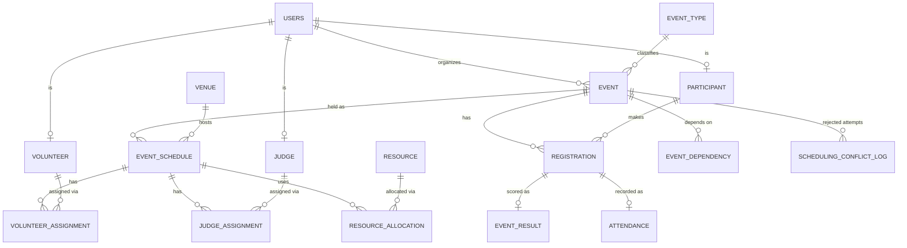

# Event Management & Dynamic Scheduling System

A full-stack event management application built using React, Express.js, and PostgreSQL. The system helps organize college events and prevents scheduling conflicts involving venues, participants, judges, volunteers, and resources.

🌐 **Live Demo:** https://event-scheduler-z5hz.onrender.com/schedule

## Tech Stack

* **Frontend:** React, Vite
* **Backend:** Node.js, Express.js
* **Database:** PostgreSQL (Neon)
* **Database Driver:** `pg`
* **Authentication:** JWT
* **Password Security:** bcrypt
* **Database Programming:** SQL and PL/pgSQL
* **Deployment:** Render

## Key Features

* Event creation, updating, and management
* Role-based authentication for administrators, organizers, participants, judges, and volunteers
* Participant registration with deadline and capacity validation
* Dynamic scheduling with live validation
* Venue availability and capacity checks
* Participant, judge, and volunteer conflict detection
* Resource allocation and availability tracking
* Event attendance and result management
* Dashboard and analytics
* Database transactions with automatic rollback on failure
* PostgreSQL constraints, triggers, stored functions, views, and indexes

## Architecture

The application follows a layered architecture:

**React + Vite → Express REST API → `pg` → PostgreSQL (Neon)**

The project does not use an ORM. Database queries are written explicitly in SQL, and critical scheduling rules are enforced directly in PostgreSQL using constraints, triggers, PL/pgSQL functions, and transactions.

---

# Running the Project Locally

## Prerequisites

* Node.js and npm
* A PostgreSQL database
* A Neon PostgreSQL database URL or another compatible PostgreSQL connection string
* Git

## Installation and Setup

Clone the repository and open the project directory:

```bash
git clone <your-github-repository-url>
cd event-scheduler
```

Install the root, server, and client dependencies:

```bash
npm install
npm run setup
```

Create a `.env` file from the example:

```bash
cp .env.example .env
```

Configure the environment variables in `.env`:

```env
DATABASE_URL=your_postgresql_connection_string
JWT_SECRET=your_secret_key
```

Use your actual database connection string and a strong secret for JWT signing. Keep `.env` private and never commit it to GitHub.

## Database Setup

Run the database setup script:

```bash
npm run db:setup
```

This initializes the database schema and loads the functions, triggers, views, indexes, and seed data.

**Warning:** The database setup script drops and recreates the project's tables. Use an empty or dedicated development database, not a database containing data you need to preserve.

If PostgreSQL refuses to create the `btree_gist` or `pgcrypto` extension, enable the required extensions through the Neon SQL Editor if your database permissions allow it.

## Start the Application

Run the backend and frontend development servers:

```bash
npm run dev
```

Open the frontend at:

```text
http://localhost:5173
```

The Express API runs on port `5000`.

Alternatively, build the frontend and serve the application through one process:

```bash
npm start
```

Open:

```text
http://localhost:5000
```

## Demo Accounts

The seeded development accounts use the password `password123`.

| Role          | Email                |
| ------------- | -------------------- |
| Administrator | `admin1@uni.edu`     |
| Organizer     | `organizer1@uni.edu` |
| Participant   | `student1@uni.edu`   |
| Judge         | `judge1@uni.edu`     |
| Volunteer     | `volunteer1@uni.edu` |

These credentials are intended for the seeded development environment. Do not use the example password for real accounts.

Seeded event dates are relative to the day the database is initialized.

---

# Demo Scenarios

Open **Schedule → + Schedule event**. The scheduling checklist is computed by the database as the user changes the scheduling details.

| #  | Action                                                                                                                   | Expected Result                                           |
| -- | ------------------------------------------------------------------------------------------------------------------------ | --------------------------------------------------------- |
| 1  | Open Events and create an event                                                                                          | Event created                                             |
| 2  | Log in as `student1`, open an event with OPEN status, and register                                                       | Registration succeeds; duplicate registration is rejected |
| 3  | Schedule Data Science Workshop in Computer Lab 1 at an available time after its registration deadline                    | Accepted                                                  |
| 4  | Schedule Game Dev Jam in Seminar Hall A during Cloud Computing Seminar                                                   | Rejected due to venue conflict                            |
| 5  | Schedule Data Science Workshop during Robotics Competition at any venue                                                  | Rejected due to participant conflicts                     |
| 6  | Schedule Open Mic Evening with judge Ananya Sharma during Robotics Competition                                           | Rejected due to judge conflict                            |
| 7  | Schedule Open Mic Evening during AI Hackathon Finals using two projectors when three exist and two are already allocated | Rejected due to insufficient resources                    |
| 8  | Schedule Career Guidance Seminar with 28 registered participants in a conference room with 25 seats                      | Rejected due to venue capacity                            |
| 9  | Repeat scenario 7 at a time after AI Hackathon Finals ends                                                               | Accepted if all other checks pass                         |
| 10 | Delete or cancel a scheduled session and inspect the Resources page                                                      | Allocated quantities are restored                         |

Run the automated demonstration scenarios against a running API:

```bash
npm run demo
```

This command executes the ten demonstration scenarios against the running application.

---

# DBMS Documentation

## 1. Problem Statement

College events require coordination between organizers, participants, venues, judges, volunteers, and shared resources. Scheduling conflicts can occur when multiple events use the same venue, participants are registered for overlapping events, judges or volunteers are assigned to overlapping sessions, or resource demand exceeds availability.

The objective is to build a database-backed event management system that maintains a conflict-free schedule while preserving data integrity.

## 2. Objectives

* Design a relational database for event management.
* Normalize the database to reduce redundancy and update anomalies.
* Enforce integrity rules directly within PostgreSQL.
* Prevent invalid or conflicting schedules.
* Make multi-step scheduling operations atomic.
* Manage participant registration, attendance, results, and resource allocation.
* Provide views and queries for reporting and analytics.

## 3. Functional Requirements

* Authentication and role-based access control.
* Event creation, retrieval, updating, and deletion.
* Participant registration with deadline, capacity, and conflict checks.
* Venue, judge, volunteer, and resource management.
* Dynamic scheduling with live validation.
* Attendance and event result management.
* Dashboard statistics and analytics.

## 4. Non-Functional Requirements

* Database-level integrity enforcement.
* Concurrency-safe scheduling through row locks, advisory locks, and exclusion constraints.
* Password hashing using bcrypt.
* JWT-based authentication.
* Environment-based configuration for secrets.
* Explicit SQL queries instead of an ORM.
* Consistent JSON error responses in the format:

```json
{
  "error": {
    "code": "ERROR_CODE",
    "type": "ERROR_TYPE",
    "message": "Description of the error"
  }
}
```

---

## 5. Entity-Relationship Diagram



---

## 6. Relational Schema

The full executable database definition is available in `database/schema.sql`.

The following is a summary of the principal relations. Primary keys are marked as **PK**, unique constraints as **UK**, and foreign keys as **FK**.

### Users

`users(user_id PK, name, email UK, phone, password_hash, role, created_at)`

Stores user details and authentication information.

### Event Type

`event_type(event_type_id PK, type_name UK, description)`

Stores event categories.

### Event

`event(event_id PK, event_name, description, event_type_id FK, organizer_id FK, max_participants, duration_minutes, registration_deadline, status, created_at)`

Stores event information, its organizer, registration deadline, duration, capacity limit, and status.

### Participant

`participant(participant_id PK, user_id FK UK, registration_number UK, department, year)`

Stores participant-specific information associated with a user account.

### Judge

`judge(judge_id PK, user_id FK UK, specialization, availability_status)`

Stores judge profiles and availability.

### Volunteer

`volunteer(volunteer_id PK, user_id FK UK, department, availability_status)`

Stores volunteer profiles and availability.

### Registration

`registration(registration_id PK, event_id FK, participant_id FK, registration_date, status, UK(event_id, participant_id))`

Connects participants to events and prevents duplicate registrations.

### Venue

`venue(venue_id PK, venue_name UK, building, floor, capacity, venue_type, status)`

Stores venue information, seating capacity, and availability status.

### Event Schedule

`event_schedule(schedule_id PK, event_id FK, venue_id FK, start_time, end_time, status, created_at, UK(schedule_id, event_id))`

Stores scheduled event sessions and enforces venue-overlap restrictions through an exclusion constraint.

### Judge Assignment

`judge_assignment(assignment_id PK, judge_id FK, event_id, schedule_id, assigned_at, UK(judge_id, schedule_id))`

Assigns judges to scheduled sessions. A composite foreign key links `(schedule_id, event_id)` to the corresponding event schedule.

### Volunteer Assignment

Stores volunteer assignments to scheduled sessions, including the assigned volunteer, event, schedule, and responsibility.

### Resource

`resource(resource_id PK, resource_name UK, resource_type, total_quantity, available_quantity, status)`

Stores shared resources such as projectors and their quantities.

### Resource Allocation

`resource_allocation(allocation_id PK, resource_id FK, event_id, schedule_id, quantity, allocated_at, UK(resource_id, schedule_id))`

Tracks resource quantities allocated to scheduled sessions.

### Attendance and Event Result

The attendance and event-result tables store participant attendance and performance information. Each uses an event-participant relationship linked to registration, with a unique constraint on the event-participant pair.

### Event Dependency

`event_dependency(dependency_id PK, event_id FK, prerequisite_event_id FK, dependency_type, UK(event_id, prerequisite_event_id))`

Stores dependencies between events.

### Scheduling Conflict Log

`scheduling_conflict_log(log_id PK, event_id, attempted_by, venue_id, attempted_start, attempted_end, conflict_type, message, logged_at)`

Records rejected scheduling attempts for debugging and auditing.

---

## 7. Relationships and Cardinalities

* **Users to Events:** One user can organize multiple events.
* **Users to Participant, Judge, and Volunteer:** A user can have a corresponding role-specific profile.
* **Events to Registrations:** One event can have many registrations.
* **Participants to Registrations:** One participant can register for multiple events.
* **Events to Event Schedules:** An event can have multiple scheduled sessions.
* **Venues to Event Schedules:** A venue can host multiple sessions at different times.
* **Judges to Schedules:** Many-to-many relationship through `judge_assignment`.
* **Volunteers to Schedules:** Many-to-many relationship through `volunteer_assignment`.
* **Resources to Schedules:** Many-to-many relationship through `resource_allocation`.
* **Registrations to Attendance and Results:** Each registration can have corresponding attendance and result records.
* **Events to Events:** Many-to-many self-referencing relationship through `event_dependency`.

---

## 8. Functional Dependencies

The main functional dependencies include:

```text
user_id → name, email, phone, password_hash, role, created_at

email → user_id

event_id → event_name, description, event_type_id,
           organizer_id, max_participants, duration_minutes,
           registration_deadline, status

(event_id, participant_id) → registration_id,
                              status, registration_date

schedule_id → event_id, venue_id, start_time, end_time, status

venue_id → venue_name, building, floor, capacity,
           venue_type, status

(resource_id, schedule_id) → quantity

(judge_id, schedule_id) → assignment_id

registration_number → participant_id, department, year
```

These dependencies guide the normalization of the database and the selection of keys.

---

## 9. Normalization

### First Normal Form (1NF)

* All columns contain atomic values.
* There are no repeating groups.
* Many-to-many relationships are represented using junction tables.

### Second Normal Form (2NF)

* The schema satisfies 1NF.
* Non-key attributes in junction tables depend on the whole candidate key rather than only part of a composite key.

### Third Normal Form (3NF)

* The schema satisfies 2NF.
* Non-key attributes depend on keys rather than transitively on other non-key attributes.

### BCNF

The intended design ensures that the modeled functional dependencies have candidate keys as determinants, where applicable.

### Deliberate, Controlled Redundancy

Some values are retained to simplify operations, with database rules used to keep them consistent:

1. **`event_id` in assignment tables:** The event can be identified through `schedule_id`, but the event ID is retained for simpler queries. A composite foreign key ensures that the schedule and event IDs match.
2. **`resource.available_quantity`:** This value is maintained through triggers and represents the quantity not held by ongoing schedules. Time-window availability is calculated using `check_resource_availability()`.
3. **`end_time`:** The scheduling function derives the end time from the start time and event duration, while a check constraint enforces `end_time > start_time`.

---

## 10. Database Constraints

The database uses the following constraints to preserve consistency.

### Primary Key Constraints

Every principal table has a primary key, using identity columns where appropriate.

### Unique Constraints

Examples include:

* `users.email`
* `participant.registration_number`
* `(event_id, participant_id)` in registrations
* `(judge_id, schedule_id)` in judge assignments
* `(resource_id, schedule_id)` in resource allocations
* Event-participant pairs in attendance and results

### Foreign Key Constraints

Foreign keys enforce relationships between users, events, schedules, registrations, assignments, venues, and resources.

Deletion behavior is configured explicitly, using cascading deletion for appropriate owned child records and restrictions where deletion could violate integrity.

### NOT NULL Constraints

Mandatory columns cannot contain `NULL`.

### CHECK Constraints

Examples include:

* Valid user roles and statuses.
* Positive venue capacity.
* Positive allocation quantities.
* Valid participant year range.
* `end_time > start_time`.
* `available_quantity BETWEEN 0 AND total_quantity`.
* `check_out >= check_in`.
* No self-referencing event dependency.
* Valid email format.

### Exclusion Constraint

The `no_venue_overlap` exclusion constraint prevents overlapping active sessions at the same venue.

Conceptually, it compares equal venue IDs and overlapping half-open time ranges:

```text
(venue_id =, tstzrange(start_time, end_time, '[)') &&)
```

Cancelled sessions are excluded from this restriction.

This provides a database-level safeguard against concurrent requests attempting to reserve the same venue for overlapping periods.

---

## 11. Database Views

The view definitions are available in `database/views.sql`.

| View                    | Purpose                                                      |
| ----------------------- | ------------------------------------------------------------ |
| `venue_schedule`        | Displays scheduled sessions by venue                         |
| `upcoming_events`       | Lists upcoming events                                        |
| `participant_schedule`  | Displays participant schedules                               |
| `judge_schedule`        | Displays judge assignments and schedules                     |
| `volunteer_schedule`    | Displays volunteer assignments and schedules                 |
| `event_statistics`      | Provides event statistics using ranking functions            |
| `resource_utilization`  | Reports resource usage                                       |
| `venue_utilization`     | Analyzes venue utilization using LATERAL queries and ranking |
| `participant_conflicts` | Identifies participant scheduling conflicts                  |
| `unscheduled_events`    | Identifies events without a scheduled session                |

These views simplify reporting and analytics without requiring each query to rebuild the same joins.

---

## 12. Database Triggers

The trigger definitions are available in `database/triggers.sql`.

| Trigger                             | Table                                      | Purpose                                                                                                                                                                 |
| ----------------------------------- | ------------------------------------------ | ----------------------------------------------------------------------------------------------------------------------------------------------------------------------- |
| `trg_validate_schedule`             | `event_schedule`                           | Validates status, deadline, venue availability, capacity, participant conflicts, and dependencies. It also rechecks assignments and resources when a schedule is moved. |
| `trg_validate_registration`         | `registration`                             | Validates registration deadlines, event capacity, venue capacity, and participant conflicts. It locks the event before the participant.                                 |
| `trg_validate_judge_assignment`     | Judge assignments                          | Checks judge availability and overlapping assignments.                                                                                                                  |
| `trg_validate_volunteer_assignment` | Volunteer assignments                      | Checks volunteer availability and overlapping assignments.                                                                                                              |
| `trg_validate_allocation`           | `resource_allocation`                      | Ensures peak concurrent resource usage does not exceed total quantity.                                                                                                  |
| `trg_sync_resource`                 | `resource_allocation`                      | Maintains `available_quantity` when allocations are inserted, updated, or deleted.                                                                                      |
| `trg_schedule_status`               | `event_schedule`                           | Handles schedule status changes and resource, judge, and volunteer availability updates.                                                                                |
| `trg_dependency_cycle`              | `event_dependency`                         | Rejects dependency cycles using a recursive CTE.                                                                                                                        |
| `trg_role_*`                        | Participant, judge, and volunteer profiles | Ensures each profile belongs to a user with the matching role.                                                                                                          |

Triggers provide automatic validation and maintenance when database records change, including changes that do not originate from the user interface.

---

## 13. Stored Functions

The function definitions are available in `database/functions.sql`.

### Availability and Validation Functions

* `check_venue_availability`
* `check_venue_capacity`
* `check_participant_conflict`
* `check_judge_conflict`
* `check_volunteer_conflict`
* `check_resource_availability`
* `check_dependencies`
* `get_available_venues`

These functions check whether a proposed event schedule satisfies the system's rules.

### Scheduling Functions

**`preview_schedule`**

Performs a dry run and returns individual validation results. The frontend uses these results to display the live checklist of scheduling checks.

**`schedule_event`**

Performs the scheduling operation atomically after validating the proposed session.

### Maintenance Functions

* `cancel_schedule`
* `refresh_schedule_statuses`
* `recalc_resource`

These functions support cancellation, schedule status updates, and resource availability recalculation.

### Custom SQLSTATE Codes

The application uses custom SQLSTATE codes to identify scheduling failures:

| Code    | Meaning                            |
| ------- | ---------------------------------- |
| `SC001` | Venue conflict                     |
| `SC002` | Capacity conflict                  |
| `SC003` | Participant conflict               |
| `SC004` | Judge conflict                     |
| `SC005` | Volunteer conflict                 |
| `SC006` | Resource conflict                  |
| `SC007` | Dependency violation               |
| `SC008` | Deadline or event status violation |

The API maps these errors to HTTP `409 Conflict` responses.

---

## 14. Transactions and Concurrency Control

The scheduling API performs the scheduling operation within a transaction.

Conceptually, the request follows:

```sql
BEGIN;
SELECT schedule_event(...);
COMMIT;
```

The application uses a transaction helper such as `withTransaction` to manage the transaction lifecycle.

### Scheduling Workflow

1. Lock the relevant event, venue, judge, volunteer, and resource rows in sorted ID order.
2. Acquire per-participant advisory locks where needed.
3. Validate the proposed schedule through `preview_schedule`.
4. Insert the schedule record.
5. Insert the judge assignments.
6. Insert the volunteer assignments.
7. Insert the resource allocations.
8. Update the event status to `SCHEDULED`.
9. Commit the transaction.

### Rollback

If any validation or insertion fails, the transaction rolls back.

For example, if an event has a valid venue but insufficient projectors, the scheduling request fails without leaving a partially created schedule or partial resource allocations.

Rejected attempts are logged in `scheduling_conflict_log` after the failed transaction has rolled back.

The venue exclusion constraint provides an additional safeguard against overlapping reservations caused by concurrent requests.

---

## 15. Indexes

The index definitions are available in `database/indexes.sql`.

Unique constraints automatically create indexes for the corresponding unique keys. The GiST index supporting `no_venue_overlap` assists venue-overlap checks.

Additional indexes include:

* `event(status)`
* `event(organizer_id)`
* `event(registration_deadline)`
* `event_schedule(event_id)`
* `event_schedule(venue_id, start_time)`
* A partial index on `event_schedule(start_time, end_time)` for sessions whose status is not `CANCELLED`
* `registration(participant_id)`
* Assignment-table indexes on `schedule_id`
* `resource_allocation(schedule_id)`
* `scheduling_conflict_log(logged_at DESC)`

The indexes are intended to improve filtering, joining, scheduling validation, and reporting performance. The rationale for individual indexes is documented alongside their definitions.

---

## 16. SQL Query Examples

The sample queries are available in `database/sample_queries.sql`.

The file contains 16 example queries demonstrating SQL and relational database concepts, including:

1. Upcoming events.
2. Venue availability.
3. Aggregate filtering using `HAVING`.
4. Participants registered for multiple events.
5. Resource utilization.
6. Ranking the busiest judges using `RANK`.
7. Scheduling conflicts.
8. Attendance information.
9. Window-function ranking.
10. `NOT EXISTS` queries.
11. Resource availability using a CTE.
12. Personal schedules.
13. Recursive event dependency chains.
14. Multi-table joins.
15. Aggregation and grouping.
16. Scheduling and resource-related reporting.

These examples demonstrate joins, subqueries, aggregate functions, common table expressions, window functions, and recursive queries.

---

## 17. Conflict Detection Logic

All scheduling overlaps use half-open time ranges:

```text
[start_time, end_time)
```

This means an event can end at the exact time another event starts without being considered an overlap.

### Venue Conflicts

Venue conflicts are checked using `check_venue_availability` and enforced through the venue exclusion constraint.

Two active sessions cannot occupy the same venue during overlapping time intervals.

### Participant Conflicts

The system identifies participants registered for multiple events whose scheduled sessions overlap.

Participant conflicts are checked during both scheduling and registration.

### Judge and Volunteer Conflicts

The system checks whether the assigned judge or volunteer is available and whether they already have an overlapping active assignment.

### Resource Conflicts

The system calculates peak concurrent demand across overlapping resource allocations.

The total required quantity must not exceed the resource's total quantity.

For example, if three projectors exist and two are already allocated to another overlapping session, a request for two additional projectors must be rejected.

The same request may be accepted if the existing session finishes before the requested session starts.

### Capacity Conflicts

The number of registered participants must not exceed the venue's capacity.

Capacity is checked when scheduling an event and when registering a participant.

### Dependency Conflicts

Event dependencies define scheduling relationships between events.

* `MUST_COMPLETE_BEFORE` requires the prerequisite event to be scheduled and completed before the dependent event begins.
* `MUST_START_AFTER` requires the prerequisite event to start earlier.

Recursive dependency-cycle detection prevents circular dependencies.

### Deadline and Status Validation

The event must satisfy the registration-deadline rules and have an eligible status, such as `DRAFT`, `OPEN`, or `SCHEDULED`, as required by the scheduling operation.

---

## 18. Screenshots and Demonstration Flow

Use the following sequence to demonstrate the application:

1. Log in using the administrator account.
2. Open the Dashboard and display live statistics.
3. Open Schedule and display the timeline.
4. Select **+ Schedule event**.
5. Change the proposed schedule and observe the live validation checklist.
6. Demonstrate a venue conflict.
7. Demonstrate a judge or resource conflict.
8. Demonstrate a successful scheduling operation.
9. Open Resources and show resource availability.
10. Open Analytics and display the reports.
11. Run `npm run demo` and show the test results.

Recommended screenshots:

* Dashboard with event counts.
* Schedule timeline.
* Scheduling form with a failed validation check.
* Successful event scheduling.
* Resource availability after scheduling and cancellation.
* Analytics dashboard.
* Terminal output from `npm run demo`.

---

## 19. Project Structure

The main project directories are organized as follows:

```text
event-scheduler/
├── client/
│   └── React + Vite frontend
├── server/
│   ├── Express REST API
│   ├── routes/
│   ├── controllers/
│   ├── services/
│   ├── db/
│   └── scripts/
│       └── demo-scenarios.js
├── database/
│   ├── schema.sql
│   ├── functions.sql
│   ├── triggers.sql
│   ├── views.sql
│   ├── indexes.sql
│   ├── seed.sql
│   └── sample_queries.sql
├── .env.example
├── package.json
└── README.md
```

The actual directory contents may include additional files depending on the current version of the repository.

### Frontend — `client/`

Contains the React user interface and Vite development configuration.

### Backend — `server/`

Contains the Express REST API, request routes, controllers, services, and database access logic.

### Database — `database/`

Contains the schema, stored functions, triggers, views, indexes, seed data, and sample SQL queries.

### Demonstration Tests — `server/scripts/demo-scenarios.js`

Contains the end-to-end demonstration scenarios used by `npm run demo`.

---

## 20. Deployment

The application is deployed on Render, with PostgreSQL hosted on Neon.

**Live application:** https://event-scheduler-z5hz.onrender.com/schedule

The deployed frontend communicates with the backend API, which uses PostgreSQL to persist application data and enforce scheduling rules.

For local development, configure the database URL and JWT secret through environment variables. Never commit database credentials, JWT secrets, or other private configuration values to the repository.

---

## Conclusion

The Event Management & Dynamic Scheduling System demonstrates how a relational database can support a full-stack application while enforcing complex business rules at the database level.

By combining normalization, constraints, triggers, stored functions, views, indexes, and transactions, the system aims to prevent scheduling conflicts, preserve consistency under concurrent requests, and provide useful event management and analytics features.
