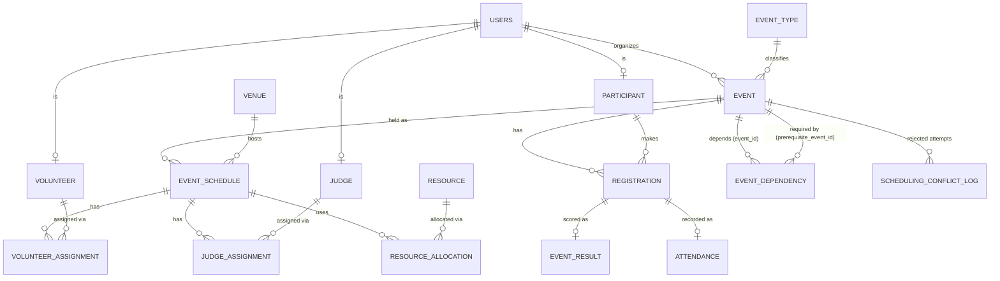

# Event Management & Dynamic Scheduling System
DBMS course project. **React + Vite → Express REST API → `pg` → PostgreSQL (Neon)**. No ORM: every query is explicit SQL, and the scheduling rules live in the database (constraints, triggers, PL/pgSQL functions, transactions).

## Run it
```bash
cp .env.example .env            # set DATABASE_URL (Neon string with ?sslmode=require), JWT_SECRET
npm install && npm run setup    # root tools + server + client dependencies
npm run db:setup                # drops & recreates ALL tables, then loads functions, triggers, views, indexes, seed
npm run dev                     # API :5000 + Vite :5173  (open http://localhost:5173)
# or one process:  npm start    # builds the client, serves UI + API on http://localhost:5000
npm run demo                    # runs the 10 demo scenarios against a running API
```
If `CREATE EXTENSION btree_gist` / `pgcrypto` is refused, run each once in Neon's SQL editor. Use an empty database: `db:setup` is destructive.

**Logins** (password `password123`): `admin1@uni.edu`, `organizer1@uni.edu`, `student1@uni.edu`, `judge1@uni.edu`, `volunteer1@uni.edu`. Seed dates are relative to the day you run it.

## Demo scenarios (UI: Schedule → "+ Schedule event"; the checklist is computed by the database as you type)
| # | Do this | Expected |
|---|---|---|
| 1 | Events → Create event | created |
| 2 | Log in as `student1`, open an OPEN event → Register | registered; registering twice is rejected |
| 3 | Schedule *Data Science Workshop*, Computer Lab 1, any free time after its deadline | ACCEPT |
| 4 | Schedule *Game Dev Jam* in Seminar Hall A during the *Cloud Computing Seminar* | REJECT (venue) |
| 5 | Schedule *Data Science Workshop* during *Robotics Competition* (any venue) | REJECT (12 participants clash) |
| 6 | Schedule *Open Mic Evening* with judge Ananya Sharma during *Robotics Competition* | REJECT (judge) |
| 7 | Schedule *Open Mic Evening* during *AI Hackathon Finals* with 2 Projectors (3 total, 2 in use) | REJECT (resource) |
| 8 | Schedule *Career Guidance Seminar* (28 registered) in Conference Room (25 seats) | REJECT (capacity) |
| 9 | Same as 7 but later that day, after the Finals end | ACCEPT |
| 10 | Schedule list → Delete/Cancel a session; Resources page shows quantities free again | restored |

---
# DBMS documentation
## 1-2. Problem statement and objectives
Given events, participants, venues, judges, volunteers and resources, create and maintain a **conflict-free schedule while preserving database consistency**. Objectives: model the domain in 3NF; make illegal schedules *impossible to store* (not just discouraged in the UI); make multi-step scheduling atomic; expose database-computed analytics.

## 3-4. Requirements
**Functional:** authentication with roles (ADMIN, ORGANIZER, PARTICIPANT, JUDGE, VOLUNTEER); event CRUD; registration with deadline, capacity and clash checks; venue/judge/volunteer/resource management; dynamic scheduling with live validation; attendance and results; dashboard and analytics.
**Non-functional:** integrity enforced inside PostgreSQL; concurrency-safe (row locks, advisory locks, exclusion constraint); bcrypt password hashes, JWT sessions, secrets in `.env`; explicit SQL; consistent JSON errors (`{error:{code,type,message}}`).

## 5. ER diagram


## 6-9. Relational schema, keys, cardinalities
Full executable DDL: `database/schema.sql`. Summary (PK **bold**, UK unique, FK →):
- **users**(**user_id**, name, email UK, phone, password_hash, role, created_at)
- **event_type**(**event_type_id**, type_name UK, description)
- **event**(**event_id**, event_name, description, event_type_id→event_type, organizer_id→users, max_participants, duration_minutes, registration_deadline, status, created_at)
- **participant**(**participant_id**, user_id→users UK, registration_number UK, department, year); **judge**(**judge_id**, user_id→users UK, specialization, availability_status); **volunteer**(**volunteer_id**, user_id→users UK, department, availability_status)
- **registration**(**registration_id**, event_id→event, participant_id→participant, registration_date, status, UK(event_id, participant_id))
- **venue**(**venue_id**, venue_name UK, building, floor, capacity, venue_type, status)
- **event_schedule**(**schedule_id**, event_id→event, venue_id→venue, start_time, end_time, status, created_at, UK(schedule_id, event_id), EXCLUDE no_venue_overlap)
- **judge_assignment**(**assignment_id**, judge_id→judge, event_id, schedule_id, assigned_at, UK(judge_id, schedule_id), FK(schedule_id, event_id)→event_schedule); **volunteer_assignment** (same shape + responsibility); **resource_allocation**(**allocation_id**, resource_id→resource, event_id, schedule_id, quantity, allocated_at, UK(resource_id, schedule_id), FK(schedule_id, event_id)→event_schedule)
- **resource**(**resource_id**, resource_name UK, resource_type, total_quantity, available_quantity, status)
- **attendance** / **event_result**(**id**, event_id, participant_id, …, UK(event_id, participant_id), FK(event_id, participant_id)→registration)
- **event_dependency**(**dependency_id**, event_id→event, prerequisite_event_id→event, dependency_type, UK pair)
- **scheduling_conflict_log**(**log_id**, event_id, attempted_by, venue_id, attempted_start/end, conflict_type, message, logged_at)

Cardinalities: USERS 1:N EVENT; USERS 1:0..1 PARTICIPANT/JUDGE/VOLUNTEER; EVENT M:N PARTICIPANT (REGISTRATION); EVENT 1:N EVENT_SCHEDULE; VENUE 1:N EVENT_SCHEDULE; JUDGE/VOLUNTEER/RESOURCE M:N EVENT_SCHEDULE through their junction tables; REGISTRATION 1:0..1 ATTENDANCE and EVENT_RESULT; EVENT M:N EVENT (self-referencing, EVENT_DEPENDENCY).

## 10-11. Functional dependencies and normalization (to 3NF/BCNF)
`user_id → name,email,phone,password_hash,role,created_at` · `email → user_id` · `event_id → event_name,description,event_type_id,organizer_id,max_participants,duration_minutes,registration_deadline,status` · `(event_id,participant_id) → registration_id,status,registration_date` · `schedule_id → event_id,venue_id,start_time,end_time,status` · `venue_id → venue_name,building,floor,capacity,venue_type,status` · `(resource_id,schedule_id) → quantity` · `(judge_id,schedule_id) → assignment_id` · `registration_number → participant_id,department,year`.
- **1NF:** atomic columns, no repeating groups (M:N relations use junction tables). **2NF:** in every junction table non-key attributes depend on the whole composite key. **3NF/BCNF:** every determinant above is a candidate key, so no transitive dependencies.
- **Deliberate, controlled redundancy:** (1) `event_id` in the three assignment tables is determined by `schedule_id`. It is kept (it simplifies queries) but guarded by the composite FK `(schedule_id,event_id)→event_schedule`, so it can never disagree. (2) `resource.available_quantity` is derived; it is maintained only by triggers and means "units not held by an ONGOING schedule right now". Time-window availability is computed from allocations by `check_resource_availability()`, never from this column. (3) `end_time` is derived from `start_time + duration_minutes` by `schedule_event()` and validated by `end_time > start_time`.

## 12. Constraints
PK on every table (identity columns); UNIQUE: `users.email`, `participant.registration_number`, registration/assignment/allocation/attendance/result pairs; FK with explicit ON DELETE (CASCADE for owned children, RESTRICT elsewhere); NOT NULL on mandatory columns; CHECK: role/status enums, `capacity > 0`, `quantity > 0`, `year 1..6`, `end_time > start_time`, `available_quantity BETWEEN 0 AND total_quantity`, `check_out >= check_in`, no self dependency, email format; **EXCLUDE** `no_venue_overlap` on `(venue_id =, tstzrange(start,end,'[)') &&) WHERE status <> 'CANCELLED'`.

## 13. Views (`database/views.sql`)
`venue_schedule`, `upcoming_events`, `participant_schedule`, `judge_schedule`, `volunteer_schedule`, `event_statistics` (RANK window), `resource_utilization`, `venue_utilization` (LATERAL + RANK), `participant_conflicts`, `unscheduled_events`.

## 14. Triggers (`database/triggers.sql`): each closes a gap CHECK/FK cannot
| Trigger | Table | Purpose |
|---|---|---|
| trg_validate_schedule | event_schedule | status, deadline, venue availability, capacity, participant clashes, dependencies; re-checks judges/volunteers/resources when a schedule is moved |
| trg_validate_registration | registration | deadline, max participants, venue capacity, participant clash; locks event then participant |
| trg_validate_judge_assignment / volunteer_assignment | assignments | availability + no overlapping assignment (row-locked) |
| trg_validate_allocation | resource_allocation | peak concurrent usage never exceeds `total_quantity` |
| trg_sync_resource | resource_allocation | maintains `available_quantity` on insert/update/delete |
| trg_schedule_status | event_schedule | cancel releases resources/judges/volunteers; ONGOING/COMPLETED refreshes availability |
| trg_dependency_cycle | event_dependency | rejects cycles with a recursive CTE |
| trg_role_* | participant/judge/volunteer | profile must belong to a user with the matching role |

## 15. Stored functions (`database/functions.sql`)
`check_venue_availability`, `check_venue_capacity`, `check_participant_conflict`, `check_judge_conflict`, `check_volunteer_conflict`, `check_resource_availability`, `check_dependencies`, `get_available_venues`, **`preview_schedule`** (dry run, one row per check; drives the ✓/✗ panel), **`schedule_event`** (atomic scheduling), `cancel_schedule`, `refresh_schedule_statuses`, `recalc_resource`. Custom SQLSTATEs: SC001 venue, SC002 capacity, SC003 participant, SC004 judge, SC005 volunteer, SC006 resource, SC007 dependency, SC008 deadline/status; the API maps them to HTTP 409.

## 16. Transactions
`POST /api/schedules` runs `BEGIN; SELECT schedule_event(...); COMMIT;` (`withTransaction`). Inside, `schedule_event` (1) locks the event, venue, judge, volunteer and resource rows in sorted id order (no deadlocks) plus per-participant advisory locks, (2) validates everything via `preview_schedule`, (3) inserts the schedule, judge assignments, volunteer assignments and resource allocations, (4) marks the event SCHEDULED. Any failure raises an exception and everything rolls back, so a schedule is never partially created (demo: a valid venue with too many projectors leaves zero rows). Rejected attempts are logged *after* the rollback in `scheduling_conflict_log`. The exclusion constraint is the last line of defence against races.

## 17. Indexes (`database/indexes.sql`)
UNIQUE constraints already index the junction pairs and the GiST index behind `no_venue_overlap` serves venue-overlap lookups. Added: `event(status)`, `event(organizer_id)`, `event(registration_deadline)`, `event_schedule(event_id)`, `event_schedule(venue_id,start_time)`, partial `event_schedule(start_time,end_time) WHERE status<>'CANCELLED'`, `registration(participant_id)`, `*_assignment(schedule_id)`, `resource_allocation(schedule_id)`, `scheduling_conflict_log(logged_at DESC)`. Rationale is commented beside each one.

## 18. SQL query examples
`database/sample_queries.sql`: 16 queries (upcoming events, venue availability, HAVING filters, multi-registration participants, utilization, busiest judges with RANK, conflicts, attendance, window ranking, NOT EXISTS, resource availability CTE, personal schedule, recursive dependency chain).

## 19. Conflict detection logic
All overlaps use half-open ranges `[start,end)`, so back-to-back events are legal. **Venue:** exclusion constraint + `check_venue_availability`. **Participant:** registrations of the event joined to other REGISTERED events whose active schedules overlap; checked at scheduling and at registration. **Judge/volunteer:** overlapping active assignment or unavailable status. **Resource:** peak usage `max over t of Σ quantity` of overlapping allocations, plus the request, must be ≤ `total_quantity` (so 2+2 projectors out of 3 conflicts only if the events overlap). **Capacity:** registered count ≤ venue capacity (checked both when scheduling and when registering). **Dependencies:** MUST_COMPLETE_BEFORE needs the prerequisite scheduled and finished before the start; MUST_START_AFTER needs it to start earlier; cycles are rejected. **Deadline/status:** the event must start after registration closes and be DRAFT/OPEN/SCHEDULED.

## 20. Screenshots / demo flow
Log in as `admin1` → Dashboard (live counts) → Schedule (timeline + "+ Schedule event", watch the checklist change) → run scenarios 4-9 above → Resources (quantities) → Analytics. Capture screenshots of: dashboard, schedule timeline, a failing checklist (✗ venue/judge/resource), the accepted booking, analytics, and `npm run demo` output.

## Project layout
`client/` React + Vite UI · `server/` Express API (`routes → controllers → services → db`) · `database/` schema, functions, triggers, views, indexes, seed, sample queries · `server/scripts/demo-scenarios.js` end-to-end scenario test.
